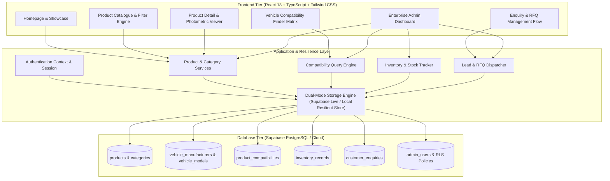
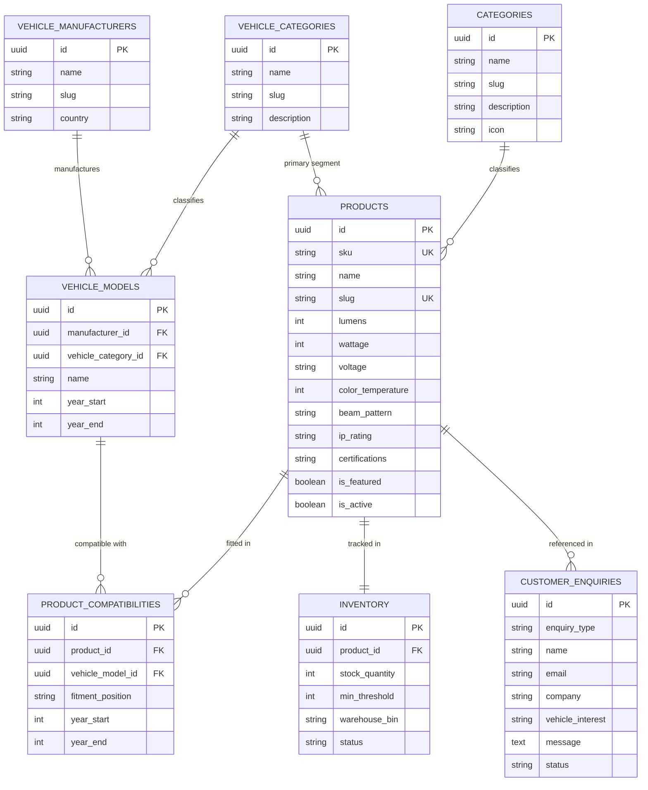

# AutoLuma — Automotive Lighting Product Catalogue & Compatibility Management System

> **Independent Educational Prototype** inspired by Tier-1 automotive lighting manufacturing leaders (such as Neolite ZKW). Built for OEM application engineering, fleet procurement, and multi-segment vehicle compatibility verification.

---

## 🌟 Executive Summary

**AutoLuma** is a full-stack, enterprise-grade Automotive Lighting Management Platform designed to eliminate fitment mismatch and streamline OEM request-for-quotations (RFQs). 

The platform bridges advanced forward lighting physics (Bi-LED projectors, laser high-beams, optical cutoff angles, ADC12 thermal dissipation) with a relational vehicle compatibility matrix spanning **Passenger Vehicles, Commercial Haulers, Two Wheelers, Three Wheelers, and Heavy Off-Road Equipment**.

---

## 🏗️ System Architecture & Technology Stack



### Core Technologies
- **Frontend Framework**: React 18 with TypeScript & Vite
- **Styling**: Tailwind CSS (Dark industrial automotive aesthetic with Navy `#0B132B`, White, Electric Cyan `#38BDF8`)
- **Visualizations**: Recharts (Monthly RFQ volume area charts, category distribution bar charts)
- **Icons**: Lucide Icons
- **Database**: Supabase with PostgreSQL (Relational schema, UUID keys, foreign key constraints, indexes, Row Level Security)
- **Data Persistence**: Dual-Mode Resilient Engine (Automatic Supabase cloud detection with transparent local high-performance fallback for offline/instant evaluation)

---

## 📋 Features Overview

### 1. Customer-Facing Website
- **Modern Homepage**:
  - Hero with automotive lighting optics imagery and animated gradient glows.
  - Interactive Cascading Vehicle Fitment Finder widget.
  - Real-time photometric performance statistics (6,800+ lumens, IP68/IP69K, AIS/ECE homologation).
  - Product line taxonomy showcase (Headlamps, Tail Lamps, Fog Lamps, DRLs, Signal, Auxiliary).
  - Vehicle segment taxonomy showcase (Passenger, Commercial, 2W, 3W, Off-Road).
  - Flagship OEM assemblies showcase.
  - Engineering & Laboratory standards introduction.
- **Product Catalogue (`/catalog`)**:
  - Live search by product name, SKU, optical technology, or feature.
  - Multi-faceted filters: Lighting category, Vehicle segment, Operating voltage (12V, 24V, EV direct 48V-72V), Ingress protection (IP67, IP68, IP69K), and Luminous flux slider (0 to 10,000+ lm).
  - Sort by Featured, Lumens (desc/asc), Power (wattage), or SKU code.
  - Toggle between Visual Grid View and Compact Technical List View.
- **Individual Product Detail Pages (`/products/:slug`)**:
  - Multi-image high-resolution gallery with thumbnail switcher.
  - Homologation and regulatory badges (ECE R112, DOT SAE, AIS-012).
  - Key photometric performance KPIs (Lumens, Wattage, Color temperature, Ingress protection).
  - Mechanical & thermal specifications (ADC12 aluminium casing, UV-hardcoated polycarbonate lens, -40°C to +105°C operating range).
  - Verified Vehicle Compatibility Matrix for each product with fitment position and model year boundaries.
  - Instant OEM RFQ / Sample Request modal prefilled with the product part number.
  - "Download Datasheet" button simulating certified OEM engineering specification sheets.
- **Vehicle Compatibility Finder (`/compatibility`)**:
  - Cascading 4-step wizard: Segment → Manufacturer (Make) → Vehicle Model → Model Year.
  - Verified compatibility cards indicating exact vehicle platform, mounting position (e.g. Front Left/Right Headlamp Assembly, Bumper Fog Pod), and harness notes.
- **Engineering, Manufacturing & Standards (`/about`)**:
  - Modeled after industrial benchmarks like Neolite ZKW.
  - Details Type-A Goniophotometer dark tunnel testing, -40°C to +105°C thermal shock testing, IP69K hot-water jet testing, and CISPR 25 Class 5 EMC suppression.
- **Contact & Technical RFQ (`/contact`)**:
  - Inbound inquiry submission with request types: Commercial RFQ, OEM Program Development, Lab Sample Testing, Fleet Bulk Supply, General Technical Query.
  - Real-time database persistence with generated Reference ID (e.g. `enq-101`).

### 2. Administrator Control Center (`/admin`)
- **Admin Authentication (`/admin/login`)**:
  - Secure credential validation with Supabase Auth support.
  - Pre-configured administrator credentials and 1-Click "Instant Admin Access" for grading/evaluators.
- **Overview Dashboard (`/admin`)**:
  - KPI metric cards: Active SKUs, Low Stock alerts, Pending Inbound RFQs, Verified Compatibilities.
  - Recharts Monthly Inbound RFQ Pipeline area chart.
  - Recharts Lighting Category Distribution bar chart.
  - Recent Inquiries quick-action table with inline workflow status changer (`new` → `in_review` → `quoted` → `resolved`).
- **Product & SKU Management (`/admin/products`)**:
  - Full CRUD: Add, Edit, and Delete products with complete photometric specifications.
  - Built-in "Auto-Gen SKU" generator button (`AL-[CAT]-[NUM]-[SUF]`).
  - Search and filter by lighting category and active/featured status.
- **Taxonomy & Category Management (`/admin/categories`)**:
  - Manage Product Lighting Categories and Vehicle Segments with real-time indexed SKU counts.
- **Vehicle Compatibility Management (`/admin/compatibility`)**:
  - Fitment Matrix Manager: Link any product to any vehicle model with mounting position and year range.
  - "Add Vehicle Model" dialog: Register new vehicle models under Tata, Mahindra, Maruti, etc.
  - Delete or unlink compatibility relationships.
- **Inventory & Stock Management (`/admin/inventory`)**:
  - Real-time inventory tracking with warehouse bin codes (e.g. `BIN-HL-A01`).
  - Automated low stock warnings when quantity drops below minimum threshold.
  - Quick stock adjustments (+5, +25, -5 units) and custom stock/bin editing dialog.
- **Customer Enquiry Management (`/admin/enquiries`)**:
  - Comprehensive inbound CRM tracking quotes, sample requests, and OEM programs.
  - Inspect full client message, target vehicle platform, company, and referenced product.
  - Transition workflow status with internal application engineering notes.
- **Analytics & Database Status (`/admin/analytics`)**:
  - Inventory valuation in Lakhs (₹), total stock units, and average luminous efficacy ratio (lm/W).
  - Supabase PostgreSQL Cloud connection monitor with instructions.
  - One-click "Export Database JSON" feature.
  - "Reset Demo Seed Data" option to instantly restore the factory database.

---

## 🗄️ Relational Database Model (Supabase PostgreSQL)

The complete SQL schema is located in `supabase/schema.sql`.



---

## 🚀 Quick Setup Instructions

### Prerequisites
- Node.js (v18 or higher recommended; v26.x tested)
- npm or pnpm

### 1. Installation
In the project directory:
```bash
npm install
```

### 2. Environment Configuration (Optional Supabase Cloud)
AutoLuma works **100% out of the box** without configuring external credentials. 

To link your live Supabase cloud database:
1. Create a free project on [supabase.com](https://supabase.com).
2. Go to the SQL Editor in your Supabase dashboard and run the entire script in `supabase/schema.sql`.
3. Copy your Project URL and Anon Public Key into `.env`:
```env
VITE_SUPABASE_URL=https://your-project.supabase.co
VITE_SUPABASE_ANON_KEY=eyJhbGciOiJIUzI1NiIsInR5cCI6IkpXVCJ9...
```
4. Restart the development server. The application will automatically detect Supabase and switch to live cloud database mode!

### 3. Launch Development Server
```bash
npm run dev
```
Open your browser at `http://127.0.0.1:5173/`.

### 4. Administrator Login Credentials
- **URL**: `http://127.0.0.1:5173/admin/login`
- **Email**: `admin@autoluma.com`
- **Password**: `autoluma2026!`
- *Alternative*: Click the **"Instant Admin Access"** button on the login screen for 1-click access.

### 5. Production Build
```bash
npm run build
```
Creates an optimized production bundle in the `dist/` directory.

---

## 🛡️ Educational Prototype Disclaimer
*AutoLuma is an independent educational software prototype developed to demonstrate modern automotive lighting product catalogues, photometric specifications, and vehicle compatibility mapping architectures. It is inspired by industrial Tier-1 manufacturers (including Neolite ZKW) but is not an official product, internal company system, or affiliate of any vehicle manufacturer or lighting corporation.*
